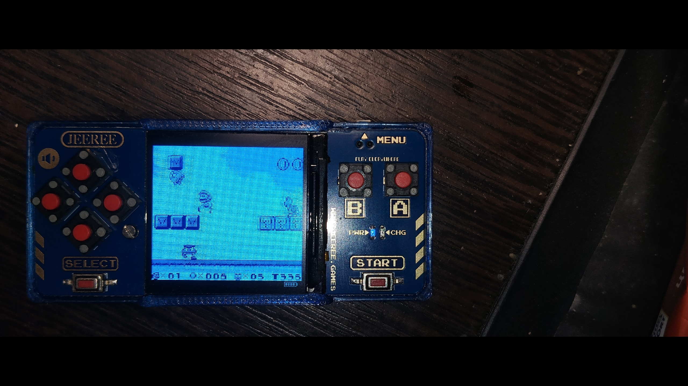

# jeeree-gbemu — Game Boy firmware for the Jeeree handheld console



An alternative firmware for the **Jeeree** handheld (RP2040-based): it turns it
into a pocket **Game Boy** with a game list, saves, savestates and a proper
menu. Flashed with a single file — no programmer, no software to install.

> 🇷🇺 По-русски — в **[README.md](README.md)**.

---

## ⚠️ Read this first (it matters)

1. **This firmware is only for the Jeeree console** (photo above). If yours
   looks different — **don't flash it**, ask first. Wrong-hardware firmware
   won't brick the device, but it won't work either.
2. **You cannot brick it.** The RP2040 has a factory bootloader built into the
   chip (BOOTSEL mode) that no firmware can erase. Whatever goes wrong, the
   console always returns to flashing mode and is fixed by flashing again.
3. **Back up YOUR stock firmware first** — 5 minutes, and it's your personal
   undo button: [docs/BACKUP.md](docs/BACKUP.md). Your backup is *yours only*:
   never use someone else's — stock builds differ between batches.
4. **No games included.** The firmware ships with a stub ROM only. You add your
   own `.gb` files from your own cartridges (see [docs/ROMS.md](docs/ROMS.md)).

Nervous? See [docs/RECOVERY.md](docs/RECOVERY.md) — every possible failure and
its fix (spoiler: flash it again).

---

## 🚀 Install (5 minutes, nothing to install)

**Step 0 (once).** Back up the stock firmware: [docs/BACKUP.md](docs/BACKUP.md).

**Step 1.** Download `gbemu_vX.Y.Z_jeeree.uf2` from
[Releases](../../releases) (newest on top).

**Step 2.** Connect the console with a USB cable that **carries data** (many
charge-only cables exist) and enter flashing mode: **hold MENU, then briefly
press START while holding it**. A drive named `RPI-RP2` appears.

**Step 3.** Drag the `.uf2` file onto the `RPI-RP2` drive. The drive
disappears, the console reboots. Done.

**Step 4.** Add games ([docs/ROMS.md](docs/ROMS.md)) and play.

---

## ✨ Features

* **Game Boy (DMG) emulation** — full speed, authentic sound.
* **Game list** for several ROMs in flash (switch without a computer).
* **Cartridge saves** are automatic + **2 savestate slots**.
* **Palettes** (including a dark-blue one matching the case), brightness,
  contrast, shade inversion — and all settings **persist across power-off**.
* **Menu**: volume, sound, game reset, sound probe, diagnostics.
* **Black box**: on a crash the console writes a report readable over USB —
  bug reports without opening the case.
* **Smart shutdown** by long-pressing a button, with saving — like stock.

---

## 🛠 Building from source

Sources live in [`gbemu/`](gbemu/) (Arduino IDE) and [`gbemu_pio/`](gbemu_pio/)
(one-command PlatformIO build). See [docs/BUILD.md](docs/BUILD.md).

The project ships with a large self-test suite (display, flash, saves, sound,
boot, sanitizers):

```bash
bash tools/check_all.sh
```

CI builds the firmware and runs the tests on every commit — release binaries
are built from this exact code.

---

## 🙏 Credits

* **[Peanut-GB](https://github.com/deltabeard/Peanut-GB)** (deltabeard, zlib) —
  the Game Boy core this firmware is built on.
* Raspberry Pi Foundation — RP2040, pico-sdk, the PlatformIO ecosystem.

---

## 📜 License & legal

* Project code — [MIT](LICENSE). Peanut-GB core — zlib (see [CREDITS.md](CREDITS.md)).
* Game Boy is a Nintendo trademark. This project is not affiliated with or
  endorsed by Nintendo; the name is used only to identify the emulated system.
* Emulation is legal. No game ROMs are included or distributed — use dumps of
  cartridges you own.
* The Jeeree stock firmware belongs to its manufacturer and is not distributed
  here either — back up your own (see above).

## ❓ FAQ

**Black screen after flashing.** Hold START (shutdown), then power on again.
If that fails — flash the file again (flashing mode always works).

**No `RPI-RP2` drive.** 9 out of 10 cases are charge-only USB cables. Try
another cable/port, repeat the MENU→START gesture.

More in [docs/RECOVERY.md](docs/RECOVERY.md) and
[Issues](../../issues).
